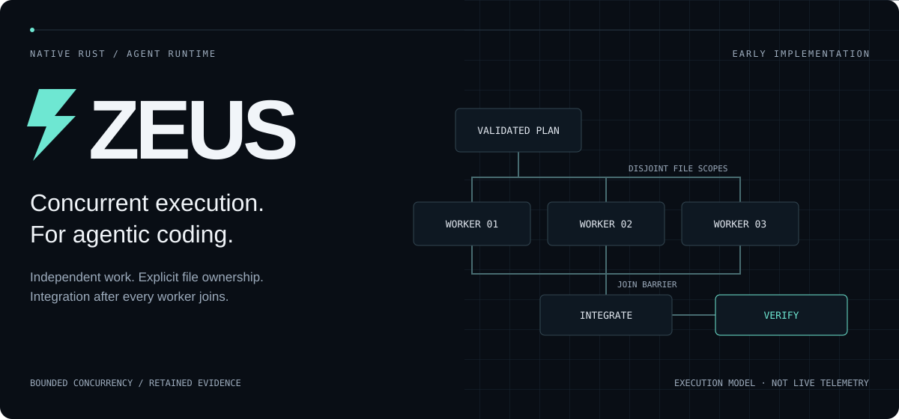

<p align="center">
  
</p>

<h1 align="center">Zeus</h1>

<p align="center"><strong>We're building toward the most advanced concurrent and parallel execution system for agentic coding.</strong></p>

<p align="center">A standalone Rust runtime for agents that work concurrently, own explicit file scopes,<br />and bring their changes together under an external verifier.</p>

<p align="center">
  <a href="#get-started">Get started</a> ·
  <a href="#the-execution-model">Execution model</a> ·
  <a href="docs/ORCHESTRATION.md">Orchestration</a> ·
  <a href="ARCHITECTURE.md">Architecture</a> ·
  <a href="SECURITY.md">Security</a>
</p>

---

## Parallel work, deliberate coordination

The ambition is advanced agent orchestration. The engineering problem is concrete: keep independent coding tasks moving without letting workers overwrite one another, widen their permissions, or mistake partial progress for a verified result.

Zeus validates file ownership before dispatch, refills available worker slots without waiting for a whole batch, and joins every admitted worker before integration. The runtime owns coordination; the model works inside its assigned authority.

| Execution | Ownership | Verification |
| :--- | :--- | :--- |
| Up to **3 concurrent workers** across **2–12 coding tasks** | Disjoint, exact-file write scopes on a private candidate | A fixed, user-selected external verifier |
| Independent contexts; available slots take the next queued task | Digest-checked edits; original source stays untouched | Bounded repair; retained audit and candidate |

> **Status: early working implementation.** “Most advanced” is the goal, not an established ranking. Zeus has no demonstrated Codex-level benchmark result. Deterministic fixtures test runtime behavior, not model intelligence; model quality and accessible evidence still bound what it can do.

## The execution model

```text
                           YOUR TASK + APPROVALS
                                    │
                           private candidate copy
                                    │
                       plan + validate file ownership
                                    │
                     ┌──────────────┼──────────────┐
                     ▼              ▼              ▼
                 worker 01      worker 02      worker 03
                 file scope     file scope     file scope
                     │              │              │
                     └──────────────┼──────────────┘
                                    │
                          join all admitted workers
                                    │
                            integration agent
                                    │
                         fixed external verifier
                                    │
                      bounded repair → retained report
```

The diagram shows the parallel route. Direct execution uses one implementer. On the parallel route, available workers claim queued tasks immediately, results preserve task order, and a published failure stops new task admission. Already-admitted work is joined; an infrastructure failure skips integration and does not train the router. This is not forcible cancellation.

Concurrency never grants authority. Coding workers cannot run the verifier, call MCP tools, open a shell, or delegate recursively. File scopes are enforced at tool dispatch, not just described in prompts. [Read the orchestration contract →](docs/ORCHESTRATION.md)

## Get started

Build locally, inspect a target without inference, then configure a job and explicitly approve the capabilities it needs. The current verifier sandbox requires macOS.

```sh
cargo build --release
./target/release/zeus inspect /absolute/path/to/artifact-or-repository
```

For a model-backed run, copy `examples/reconstruction/job.example.json` to your own job file. Configure the source, state directory, model connection and absolute external verifier path before running it. Set `"strategy": "parallel"` to request parallel work, or `"strategy": "direct"` for one implementer.

```sh
./target/release/zeus run examples/reconstruction/job.local.json \
  --allow-network --allow-exec
```

The local job file is yours to create; it is not a ready-to-run credential bundle. [Model connections](docs/PROVIDERS.md) covers supported protocols and explicit subscription login. [Task configuration](#run-a-task) below covers verifier restrictions, budgets and path rules.

## Explore the system

| Area | Contract |
| :--- | :--- |
| [Parallel orchestration](docs/ORCHESTRATION.md) | Queue semantics, coding plans, worker permissions and failure handling |
| [Bounded autonomy](docs/AUTONOMY.md) | Exact write scopes, shared inference budgets and repair limits |
| [Model connections](docs/PROVIDERS.md) · [Authentication](docs/AUTH.md) | Provider protocols, explicit credentials and subscription OAuth |
| [Project context](docs/CONTEXT.md) | Repository guidance, workspace skills, search and exact edits |
| [Run history](docs/SESSIONS.md) · [Output](docs/OUTPUT.md) | Independent-task console, retained evidence and model-facing reduction |
| [External analyzers](docs/REA.md) | Allowlisted MCP integrations for evidence-driven reverse engineering |
| [Architecture](ARCHITECTURE.md) · [Security](SECURITY.md) | Component ownership, trust boundaries and present limits |

## Implementation reference

The details below distinguish implemented behavior from the larger ambition.

<details>
<summary><strong>Capability inventory</strong> — what exists today</summary>


- Native HTTP model/tool loop supporting OpenAI-compatible Chat Completions, streamed Responses, and Anthropic Messages; no dependency on the Hermes, Codex or Prime runtime.
- Native ChatGPT subscription OAuth login, protected local credential storage, refresh, and account-specific model listing. API-key and local endpoints remain separate; no automatic billing fallback. Authentication/protocol fixtures are tested; real account authorization still requires the user's browser sign-in.
- Direct execution or model-planned work with up to three parallel coding workers, each restricted to assigned files, followed by one integration agent. Read-only analysis remains available.
- Independent-task console and read-only browsing/search of retained runs. This is not conversation resume or multi-turn candidate continuation.
- Root `AGENTS.md` project guidance, explicit workspace skill listing/reading, bounded literal search and exact digest-checked edits. Repository documents never grant permissions.
- Conservative native output reduction for successful Rust libtest verifier output shown to the model; raw audit, verification results and rewards remain unchanged. This is RTK-inspired presentation, not RTK command-wrapper parity.
- Private candidate snapshots: original targets are never intentionally edited. File writes require the current SHA-256; traversal and symlinks are rejected.
- Artifact inventory and signature identification, including unknown-format reporting. Identification is not decompilation.
- MCP stdio client with explicit server/tool allowlists for external analyzers (for example REA). A real installed REA backend has been exercised on a compiled Go artifact, confirming digest-bound compiler metadata and denial of an unlisted execution tool. Other analyzer capabilities need separate verification.
- Evidence records distinguishing observations, inferences and unknowns. Valid source references are checked; an LLM claim is not automatically established as true.
- Fixed external verification, bounded repair attempts, JSONL audit records and retained candidates.
- Persistent contextual UCB routing between direct and parallel strategies, trained only from verifier outcomes. This changes routing, not LLM weights. Infrastructure errors are not intended as training examples.

</details>

## Build and test

Requirements: Rust/Cargo and macOS for the current verifier sandbox. The test fixture also uses Python 3; the end-to-end test currently expects Homebrew Python at `/opt/homebrew/bin/python3`.

```sh
cargo build --release
cargo test
cargo fmt --all -- --check
cargo clippy --all-targets -- -D warnings
```

The executable is `target/release/zeus`. Tests include clearly labelled deterministic HTTP/MCP fixtures; passing those tests does not demonstrate model intelligence.

## Inspect without inference

```sh
./target/release/zeus inspect /absolute/path/to/artifact-or-repository
```

This reports file hashes, format candidates and skipped entries without running the target or contacting a model. Current inventory bounds: 2,000 files, 16 MiB per file, 64 MiB total. Select a focused target for larger applications. Common secret filenames and dependency/build directories are excluded; this is not general secret detection.

## Run a task

Use `examples/reconstruction/job.example.json` as a template. Set its absolute external verifier path and choose your model endpoint. Relative source/state paths resolve against the job file's directory. The state directory's parent must already exist; state must be outside the source.

`model_timeout` optionally sets the whole-request deadline in seconds (default 180, allowed 1–900), including response reads. Slow local inference shared by parallel analysts may need a larger value, for example 600. This is not a per-byte inactivity timer or a whole-job deadline. `model_retries` (default 3, allowed 0–8) retries transient failures only: HTTP 408/429/5xx, DNS and connection errors, honoring `Retry-After` up to 30 seconds, otherwise 1/2/4/8 second backoff. Deadlines and other 4xx responses are never retried; the provider's structured error code, type and message are kept in the error report, with URLs and token-like strings scrubbed; raw bodies are never copied. Every attempt counts against `autonomy.max_model_calls`. Exhausted model requests remain infrastructure errors and do not train the routing policy. OS DNS lookup remains subject to the system resolver rather than this interruptible deadline.

Verifier argv must name either one absolute external executable or an absolute interpreter followed by an absolute external script (Python's `-I` is optionally supported before the script). Relative scripts, inline code, module discovery, and extra arguments are rejected. For other invocation patterns, supply a trusted external wrapper that owns the checks. Verifier files must be outside both source and state directories; candidate-controlled tests cannot be the reward authority.

```sh
./target/release/zeus run examples/reconstruction/job.local.json \
  --allow-network --allow-exec
```

Permissions are separate:

- `--allow-network`: send task/source/tool evidence to the exact configured model endpoint. HTTPS is required except for loopback HTTP; redirects and environment proxies are disabled.
- `--allow-exec`: run the fixed user-selected verifier in the macOS sandbox. The model cannot select arbitrary commands.
- `--allow-mcp`: launch the configured MCP programs on the host and expose only allowlisted tools. This is an approval for executable host integrations, **not** a sandbox. Approve only trusted servers and tool operations.

Well-formed tool batches containing an unadvertised capability execute no calls: Zeus returns a denial for that call and a skipped result for the rest of the batch. The model can correct its request with fresh call IDs within the existing turn, call and context budgets. Denied attempts consume those budgets; calls are never automatically replayed. `AgentResult.tool_calls` counts validated attempts, including denied/skipped calls, not dispatched operations. Malformed calls, duplicate IDs and infrastructure/host failures remain fatal. Read-only analysts never gain write or execution access through recovery.

For API connections, credentials come from the named `api_key_env` environment variable, never from committed job files or automatic Hermes credential discovery. Subscription connections use the explicit ChatGPT login flow instead. Do not paste credentials into tasks. See [model connections](docs/PROVIDERS.md) for subscription login commands, model discovery, supported protocols, and example connection settings.

Set `"strategy": "parallel"` in the job to request parallel coding on the first run, or `"strategy": "direct"` for a single implementer. Omit the field to retain learned routing: the first completed training run uses the direct route, the next run in the same context explores parallel work, and subsequent choices use accumulated verified outcomes. Explicit selection does not grant any new execution or network approval. A verifier that already passes causes an `already_verified` no-op instead of unnecessary model work. Without a verifier, output is explicitly `unverified` and the CLI returns nonzero.

Parallel planner responses are limited to 64 KiB of UTF-8 text, including whitespace and framing. The planner assigns independent implementation tasks with explicit file ownership; the runtime validates the entire plan before dispatch. Legacy `tasks` arrays of 2–3 strings remain read-only. Optional surrounding whitespace and a single complete, non-nested leading `<think>...</think>` envelope are accepted only at this planner boundary. Invalid plans fail closed without a direct-route fallback or policy update. Raw planner output remains in the private audit. See [parallel execution](docs/ORCHESTRATION.md) for the structured plan and enforced permissions.

Each run retains its original/final inventories, `events.jsonl`, evidence findings, final report or infrastructure error, and the candidate directory. Policy state lives outside the candidate. A `run.lock` prevents concurrent writers to one state store. After a killed process, inspect the recorded PID before manually removing a stale lock. No automatic promotion, deployment, or overwrite of the original is performed.

## Grant bounded autonomy

Add `"autonomy": {"write_paths": ["src/parser.rs", "tests/parser.rs"], "max_repairs": 2, "max_model_calls": 40}` to your job. Zeus can work unattended inside that exact model-write scope, including parallel workers and integration, with one shared inference-request budget. Use `write_paths: []` to deny model file edits. Original source files remain untouched. Verifier execution still needs `--allow-exec`; scoped autonomy rejects unsandboxed MCP tools. See [autonomy controls](docs/AUTONOMY.md) for defaults, limits and the trusted-verifier boundary.

## Console and run history

```sh
./target/release/zeus console path/to/job.json --allow-network --allow-exec
./target/release/zeus sessions list /absolute/path/to/state
./target/release/zeus sessions search /absolute/path/to/state 'parser'
./target/release/zeus sessions show /absolute/path/to/state run-<timestamp>-<pid>
```

The console accepts a task line or `/run`, plus `/help`, `/list`, `/search`, `/show` and `/quit`. Every task snapshots the original source again; prior edits and conversations are **not** carried forward. Browsing requires no inference or execution approval. See [sessions](docs/SESSIONS.md) for bounds and exit semantics.

The model can use `search_files`, `edit_file`, `list_skills` and `read_skill` alongside existing tools. Coding workers can edit only their assigned candidate files; read-only analysts still cannot edit. The integration agent runs after every worker finishes and retains the existing approved verifier/MCP capabilities. Root `AGENTS.md` is included as bounded, untrusted project guidance. Skills live at `skills/<name>/SKILL.md`; there is no implicit Hermes/home import, skill execution or installation. See [context](docs/CONTEXT.md), [parallel execution](docs/ORCHESTRATION.md) and [output presentation](docs/OUTPUT.md) for exact scope. These are independently implemented core capabilities, not full Hermes/OpenCode/Prime/RTK parity.

## Reverse-engineering scope

Zeus is designed to route arbitrary artifact types to suitable tools and explicitly record unsupported capabilities. Source repositories can be inspected directly. Native binaries, packages, mobile applications, firmware, protocols and running applications require configured analyzers and, where necessary, authorized runtime evidence. Current built-ins alone do **not** recover these targets' internals.

Use source IDs and tool-event IDs to trace a reconstructed specification back to observations. Static interpretation, runtime observations, and source-derived facts should remain distinct. Finite tests establish only the behavior they cover, not universal equivalence or original-source recovery.

## Safety and present limitations

Read [SECURITY.md](SECURITY.md) before execution. In particular, the current macOS sandbox is not a VM and is not sufficient containment for deliberately hostile executables. MCP programs have host privileges. A user's verifier determines what a pass means; a trivial or compromised verifier cannot supply meaningful rewards.

There is no GUI, unrestricted shell, automatic analyzer installation, automatic deployment, LLM-weight training, production-grade session resume, or established Codex-level benchmark result. Model requests and tool calls are bounded; exhausted budgets and missing capabilities are errors, not successes.

See [ARCHITECTURE.md](ARCHITECTURE.md) for source-inspection notes and component ownership, and [the reconstruction exercise](examples/reconstruction/README.md) for the public fixture's contract and sensitivity checks.
