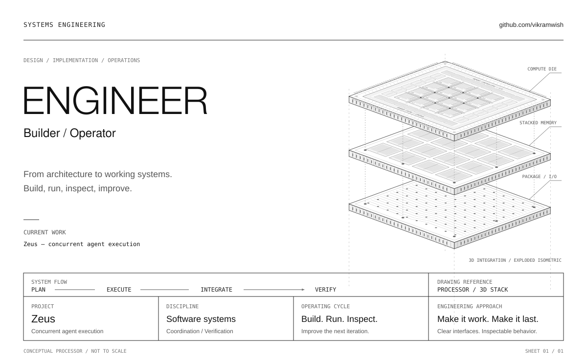

  

  <a href="https://github.com/vikramwish?tab=repositories">Repositories</a> &nbsp; / &nbsp;
  <a href="https://github.com/vikramwish/zeus">Zeus</a> &nbsp; / &nbsp;
  <a href="https://github.com/vikramwish/zeus/issues">Zeus issues</a>

## From architecture to working systems.

Engineer, builder, operator. I work on the machinery behind agentic coding: execution, coordination, and verification. I build it, run it, inspect the results, and improve the next version.

My current focus is **[Zeus](https://github.com/vikramwish/zeus)**: a standalone Rust runtime for coding agents that work concurrently, own explicit file scopes, and bring their changes together under an external verifier.

The work: turn independent agents into a system whose behavior can be inspected and whose output can be checked.

---

### On the bench — Zeus

**Independent work. Explicit ownership. Verified integration.**

Zeus validates file ownership before dispatch, assigns queued work as capacity becomes available, and waits for every admitted worker before integration.

| Coordination | Authority | Evidence |
| :--- | :--- | :--- |
| Concurrent workers with independent contexts | Explicit, disjoint file scopes | A fixed external verifier |
| Available slots take the next queued task | Edits checked against source digests | Bounded repair and retained reports |

An early working implementation, with its capabilities and limitations documented in the repository.

[Explore Zeus](https://github.com/vikramwish/zeus) &nbsp; / &nbsp; [Read the architecture](https://github.com/vikramwish/zeus/blob/HEAD/ARCHITECTURE.md) &nbsp; / &nbsp; [Execution model](https://github.com/vikramwish/zeus#the-execution-model)

---

### Operating principles

- **Concurrency with ownership.** Define who can change what before work begins.
- **Verification as a separate step.** Evaluate the integrated result with an external verifier.
- **Inspectable execution.** Retain the candidate and evidence so a run can be reviewed.
- **Close the loop.** Inspect failures, improve the implementation, and run it again.

 

Engineer / Builder / Operator
