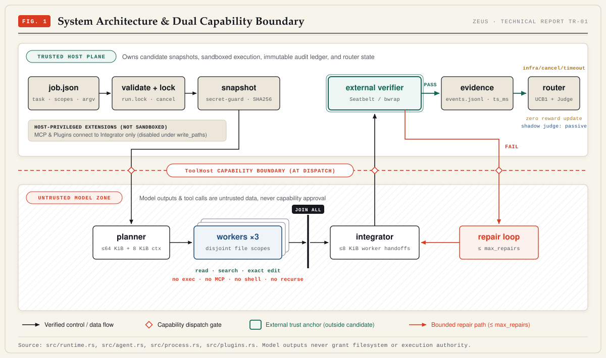
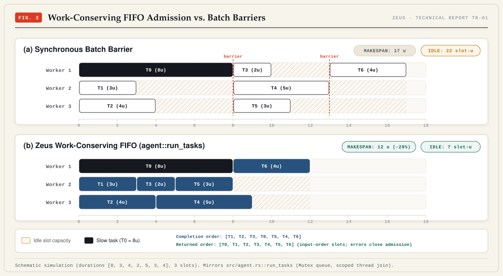
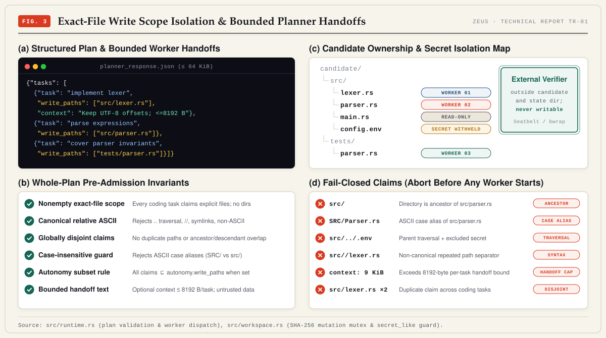
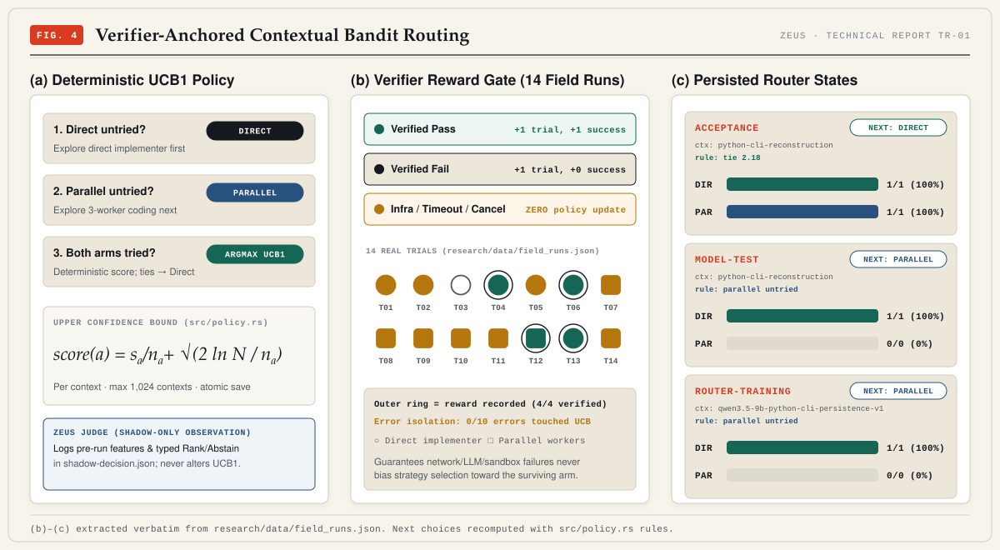
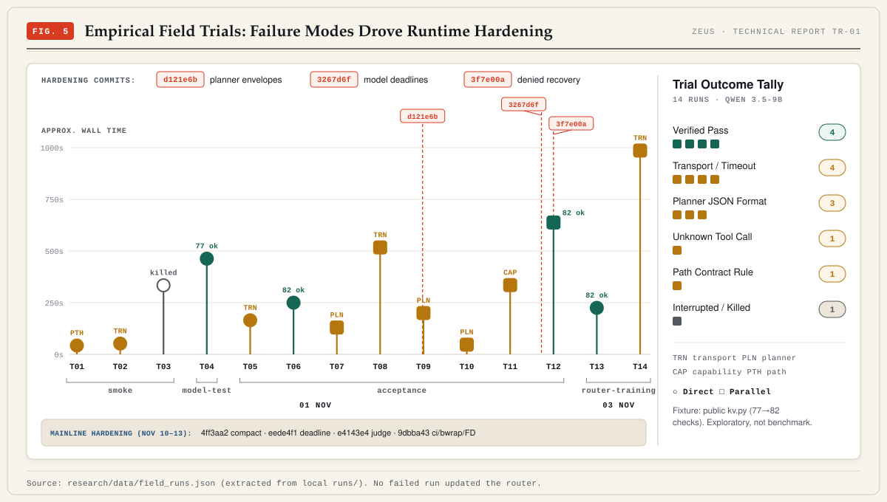
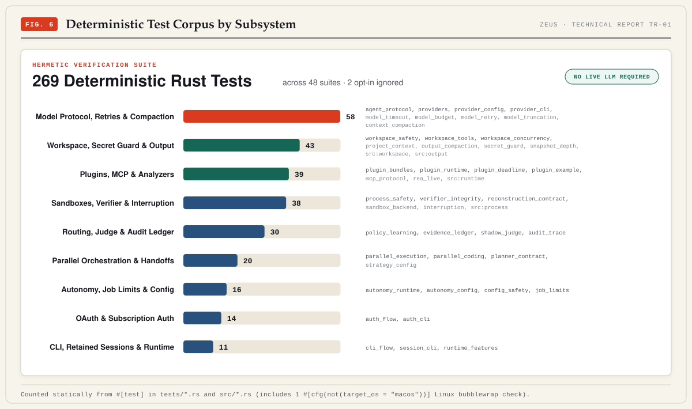
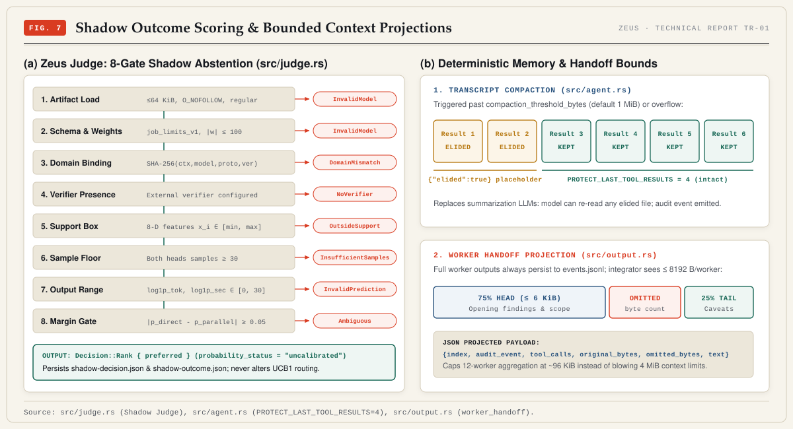

# Zeus Technical Report TR-01: Bounded Concurrency and Fail-Closed Authority for Verifiable Agentic Coding

> **Full formatted PDF:** [research/paper/zeus-report.pdf](paper/zeus-report.pdf) · **Interactive Workbench:** [research/index.html](index.html) · **Scrubbed Trial Dataset:** [research/data/field_runs.json](data/field_runs.json) · **Baseline Commit:** `0692fa6+`

---

## Abstract

Autonomous coding agents frequently treat unstructured model output as an implicit grant of system capability, stall parallel worker pools behind synchronous batch barriers, or corrupt online strategy routers whenever transient transport failures occur. **Zeus** is a standalone Rust runtime (`7,852` lines across `18` modules under `src/`) that isolates untrusted model completions behind host-enforced capabilities, OS-level verification sandboxes (macOS Seatbelt / Linux `bubblewrap`), bounded memory/handoff envelopes, and verifier-gated UCB1 policy learning paired with an 8-gate fail-closed shadow outcome scorer (*Zeus Judge*).

Across `269` deterministic Rust tests spanning `48` suites (requiring no live LLM) and `14` exploratory Qwen 3.5-9B local field trials, Zeus demonstrates work-conserving FIFO worker admission, whole-plan exact-file disjointness before worker spawn, strict `0/10` error isolation in router policy updates, and bounded transcript/handoff control. All figures, metrics, and runtime claims below are synchronized programmatically against repository state (`0692fa6+`).

---

## 1. Dual Capability Boundary

Zeus partitions every run into a **Trusted Host Plane** and an **Untrusted Model Zone** separated at the `ToolHost` dispatch boundary:



| Plane | Modules | Owned Responsibilities |
|---|---|---|
| **Trusted Host Plane** | `main.rs`, `config.rs`, `cancel.rs`, `workspace.rs`, `process.rs`, `evidence.rs`, `policy.rs`, `judge.rs`, `plugins.rs`, `mcp.rs` | CLI & `job.json` validation, `run.lock`, signal installation (no `SA_RESTART`), secret-excluding candidate cloning, Seatbelt/`bubblewrap` verifier execution, `events.jsonl` append-only audit ledger, atomic (`0o600` temp + `fsync` + rename) UCB1 saves, and shadow judge persistence. |
| **Untrusted Model Zone** | `runtime.rs`, `agent.rs`, `output.rs`, `model.rs` | Planner (`<= 64 KiB` JSON, `2–12` coding tasks), `1–3` concurrent read/search/edit workers (`no exec`, `no shell`, `no MCP`, `no recurse`), integrator consuming bounded worker handoffs, and bounded repair loop (`0–8` rounds, default `2`). |

Host-privileged extensions (local MCP servers and manifest-v1 plugins behind `--allow-plugins`, capped at `16` plugins / `64` tools / `64` skills) attach strictly to the integrator, are disabled automatically when scoped `autonomy.write_paths` are active, and force a fresh external verifier pass after any `run_end` hook mutates candidate state.

---

## 2. Work-Conserving FIFO Admission & Whole-Plan Pre-Admission Invariants

### 2.1 Work-Conserving Queue (`src/agent.rs::run_tasks`)

Instead of coarse barrier waves that stall fast workers behind a slow straggler, Zeus protects an index cursor behind a `Mutex` shared by `1..=3` scoped worker threads (`std::thread::scope`). Idle workers pull the next ready index immediately while placing results directly into their original planner slots. On an error, shared cancellation closes FIFO queue admission while running workers terminate cleanly.



In the deterministic heterogeneous trace above (durations `[8, 3, 4, 2, 5, 3, 4]` across `3` workers), work-conserving FIFO reduces makespan from `17u` to `12u` (**-29.4%**) and slashes idle slot waste from `22` to `7` slot-units (**-68.2%**).

### 2.2 Fail-Closed Scope Isolation (`src/runtime.rs`, `src/workspace.rs`)

Before spawning any worker thread, Zeus validates five whole-plan invariants across all claimed write sets `W_i`:

1. **Nonempty exact-file scope:** Every coding task declares explicit file paths (`write_paths`), never directories or empty sets.
2. **Canonical relative ASCII syntax:** Rejects leading `/`, `..` traversal segments, `//` separators, non-ASCII characters, and workspace-escaping symlinks.
3. **Global disjointness & case-insensitive guard:** Rejects duplicate claims or path-prefix overlaps across `norm(p)` (ASCII lowercase) so neither ancestors nor case aliases collide on case-insensitive filesystems.
4. **Autonomy subset enforcement:** When `autonomy.write_paths` (`<= 128` entries) is specified, every worker claim must lie within an allowed path.
5. **Bounded planner & worker handoffs:** Optional planner `context` per task and post-worker `worker_handoff` summaries cannot exceed `8,192 B` (`<= 64 KiB` planner JSON overall).

Candidate file mutations acquire `Workspace.mutation: Mutex<()>` and check SHA-256 content hashes before applying exact edits, while `Workspace::secret_like` withholds `.env` files, `PRIVATE KEY-----`, `sk-`, `AKIA`/`ASIA`, `ghp_`..`ghs_`, `xox*`, and `AIza` patterns prior to model inspection.



---

## 3. Verifier-Anchored Bandit Routing

For each context key `c` (`<= 256 B`, up to `1,024` retained contexts per policy file), `src/policy.rs` routes deterministically across `Direct` and `Parallel` arms using UCB1:

- Try `Direct` first if `trials == 0`; else `Parallel` if `trials == 0`.
- Otherwise evaluate `score(a) = s_a / n_a + sqrt(2 * ln(total) / n_a)`, breaking exact floating-point ties deterministically toward `Direct`.



Only external verifier verdicts trigger UCB updates (`+1 trial, +1 success` on verified pass; `+1 trial, +0 success` on verified fail). Across `14` exploratory field runs, `0/10` infrastructure failures (network timeouts, planner JSON errors, capability rejections, path violations, or user interrupts) altered routing weights.

---

## 4. Empirical Field Trials & Hardening Chronology

All `14` exploratory runs (`T01`–`T14`, Qwen 3.5-9B against the public `kv.py` fixture rising from `77` to `82` checks) were extracted cleanly into [research/data/field_runs.json](data/field_runs.json) with local user paths stripped.



| Outcome / Failure Class | Count | Trials | Observed Response / Hardening |
|---|---:|---|---|
| **Verified Pass** | 4 | `T04`, `T06`, `T12`, `T13` | `4/4` recorded UCB reward updates (`T04` 77 checks; `T06`, `T12`, `T13` 82 checks). |
| **Transport / Timeout** | 4 | `T02`, `T05`, `T08`, `T14` | Prompted per-request deadlines (`3267d6f`), whole-job bounds (`eede4f1`), & HTTP retries (`b9d4a4a`). |
| **Planner JSON Format** | 3 | `T07`, `T09`, `T10` | Prompted structured JSON envelopes (`d121e6b`). |
| **Unknown Tool Call** | 1 | `T11` | Prompted denied-action feedback (`3f7e00a`), immediately preceding parallel pass `T12`. |
| **Path Contract Rule** | 1 | `T01` | Validated exact-file fail-closed pre-admission rejection before worker spawn. |
| **Interrupted / Killed** | 1 | `T03` | Left UCB routing state uncorrupted (`SA_RESTART`-free signal handling). |

---

## 5. Deterministic Verification Corpus (`269` Tests, `48` Suites)

Zeus maintains `269` static `#[test]` functions across `44` integration test files (`tests/*.rs`), `3` inline unit tests in `src/runtime.rs`, `2` in `src/workspace.rs`, `1` in `src/process.rs`, and `1` in `src/output.rs` (`48` suites total; `2` opt-in `#[ignore]` tests plus OS-gated macOS Seatbelt and Linux `bubblewrap` checks), requiring zero live LLM calls.



---

## 6. Bounded Memory, Handoffs & Zeus Judge Shadow Scoring

Mainline hardening (`abf3e7a` through `e4143e4`, plus CI `bubblewrap`/FD hygiene in `9dbba43`) eliminates unbounded transcript growth, enforces verifier descriptor isolation, and introduces offline shadow scoring:



- **Transcript Compaction (`src/agent.rs`):** Past `compaction_threshold_bytes` (default `1 MiB`, floor `64 KiB`), old tool outputs are replaced with `{"elided":true}` while unconditionally protecting `PROTECT_LAST_TOOL_RESULTS = 4` recent results.
- **Worker Handoff Projection (`src/output.rs`):** Integrator prompts receive `<= 8,192 B` per worker via an asymmetric `75%` head / `25%` tail split while raw outputs remain complete in `events.jsonl`.
- **Zeus Judge (`src/judge.rs`):** Projects an 8-feature vector under `job_limits_v1` bound by `SHA-256({context, model, protocol, endpoint, verifier})`. Any artifact must pass eight fail-closed gates (`O_NOFOLLOW` `<= 64 KiB`, schema & weight magnitude `<= 100`, exact domain SHA-256 match, verifier configured, support box bounds, `>= 30` samples per head, finite predicted `log1p_tok`/`log1p_sec in [0, 30]`, and probability margin `>= 0.05`) before logging `Decision::Rank` (`probability_status = "uncalibrated"`). It never alters UCB1 routing.

---

## Scope & Honest Limitations

1. Deterministically passing unit and integration tests exercise runtime invariants against mocked HTTP servers and local test fixtures rather than open-ended software engineering benchmarks.
2. The `14` empirical trials reflect early Qwen 3.5-9B development runs on a single Python fixture (`kv.py`), not held-out benchmark generalization.
3. Deterministic verification executes end-to-end under both macOS Seatbelt and Linux `bubblewrap` in CI; the `14` exploratory Qwen 3.5-9B field trials ran on macOS.
4. No trained production `shadow-model.json` artifact is shipped; Zeus Judge remains dormant/abstaining until `>= 30` per-arm domain samples are collected.

---

## Reproducibility

```bash
# Regenerate scrubbed trial summary from runs/ (optional if runs/ present)
python3 research/scripts/extract_field_runs.py runs

# Regenerate all 8 SVGs directly from Rust source metrics + field_runs.json
python3 research/scripts/build_figures.py && python3 research/scripts/build_figures.py --check

# Re-render PDF plates & compile monograph
uv run --with playwright python research/scripts/render_figures.py
(cd research/paper && pdflatex -jobname=zeus-report zeus_report.tex && pdflatex -jobname=zeus-report zeus_report.tex)

# Run deterministic Rust verification corpus
cargo test --locked
```

